# direnv-config — Architecture

〚📁:996ac0c7-a5e0-52d9-81f6-b0a3a69d5c45〛 direnv-config PROJ-ARCH :: Architecture overview: layer resolution, IPC, secrets, SDKs, remote sync

Companion docs: security model in [THREAT-MODEL.md](THREAT-MODEL.md), component ↔ directory map in [PROJ-LAYOUT.md](PROJ-LAYOUT.md), task guides in [howto/](howto/).

## Overview

`direnv-config` replaces sprawling `export VAR=value` `.envrc` files with structured, versioned, mergeable YAML. A Rust CLI (`dc`) manages per-directory config stores under `~/.local/state/direnv-config/{path-hash}/`; a direnv stdlib extension (`dc_yaml`, `dc_load`, `dc_get`, `dc_set`, …, `dc_export`) bridges those stores into shell env vars from one-liner `.envrc` files. State lives in files, so any process — parent shell, child script, sibling tool, SDK client — can read or mutate shared config; every write bumps a monotonic `.version` counter and a `precmd` hook re-exports the environment on the next prompt (file-based IPC).

Secrets are first-class, not a bolt-on. A scalar marked `🔒` (optionally tiered with `❗`) is encrypted at rest into a self-describing `🔒:v1:t<tier>:<payload>` token using XChaCha20-Poly1305, with the single key held in an external, lockable key file. Secrets are redacted by default, reveals are audited, a `⛔` sentinel routes "locked-down" values to a shadow store, and remote sync (`dc compare`/`dc push`/`dc infisical`) compares SHA-256 digests so plaintext never crosses the wire or the terminal.

Five SDK clients (Rust, TypeScript, Python, Elixir, PHP — all read **and** write, each with a native file backend and a CLI subprocess backend) give application code the same resolution semantics without shelling out, held together by shared contract tests. A small Elixir/Hologram landing site (`web/`) ships via `helm/dirconfig-site`. In the Noizu fleet, `dc` owns `.envrc.dc` — the scalar-config/secret source of truth for trl-infra (AWS, Docker, Helm, Infisical credentials) — and realizes the credential layering `dc: → override: → auto: → default:` via `dc get` flags and `.infisical-secrets.yaml` spec keys.

## System Diagram

```mermaid
graph TB
    subgraph Project["Project directory"]
        ENVRC[".envrc* sources<br/>(dc_yaml / dc_load heredocs)"]
        EXTERN["registered external YAML files<br/>(tracked in .meta)"]
        SHADOW[".secrets/restricted.config.yaml<br/>(shadow store)"]
    end

    subgraph CLI["dc CLI (Rust)"]
        INGEST["dc yaml / dc load<br/>(split + encrypt + route)"]
        GETSET["dc get / set / unset / prune"]
        CFG["dc config get/set/setall/secure<br/>(line splice editors)"]
        SEALEMIT["dc seal / dc emit<br/>(un)seal sources, store → files"]
        ENV["dc env<br/>(flatten rules → exports)"]
        SYNC["dc compare / push / infisical"]
    end

    subgraph State["State store — ~/.local/state/direnv-config/{path-hash}/"]
        LAYERS["per config: base.yaml → DC_ENV.yaml →<br/>local.yaml → secrets.yaml"]
        ACTIVE[".active (resolved snapshot)"]
        VERSION[".version (monotonic counter)"]
        META[".meta (source dir, registered files)"]
    end

    subgraph Global["~/.config/direnv-config/"]
        KEYS["keys (0600, root-lockable)"]
        SETTINGS["settings.yaml (audit_log; legacy key)"]
    end

    subgraph Consumers["Consumers"]
        HOOK["precmd hook (dc-init)<br/>watches .version → re-eval dc env"]
        SDKS["SDKs ×5<br/>(native + CLI backends)"]
    end

    subgraph Remote["Remote backends"]
        INF["Infisical API<br/>(reqwest + rustls)"]
        K8S["K8s Secrets<br/>(kubectl)"]
    end

    ENVRC -->|heredoc| INGEST
    EXTERN -->|subject split| INGEST
    INGEST -->|deep merge per layer| LAYERS
    LAYERS -->|resolve| ACTIVE
    INGEST -->|bump| VERSION
    GETSET -->|read .active| ACTIVE
    GETSET -->|write layer| LAYERS
    CFG -->|splice source lines| ENVRC
    CFG -->|splice| EXTERN
    SEALEMIT -->|rewrite sources| ENVRC
    KEYS -->|decrypt 🔒 tokens| GETSET
    ACTIVE -->|flatten| ENV
    ENV -->|export lines| HOOK
    VERSION -->|changed?| HOOK
    SDKS -->|read/write| LAYERS
    SDKS -->|read .active| ACTIVE
    SYNC -->|SHA-256 digests / push| INF
    SYNC -->|kubectl| K8S
    GETSET -->|⛔ resolve| SHADOW
```

## Core Components

| Component | Purpose |
|-----------|---------|
| `src/cmd/` | One file per subcommand — store ops (yaml, load, get/set/unset/prune, env, bump, init, status, list, purge), secrets (secrets, gen, gen-secrets, encrypt, decrypt, bat), source editing (config, seal, emit), key mgmt (keys), remote sync (compare, push, infisical) |
| `src/store/` | State-dir discovery, path-hash store naming, advisory exclusive locking, layer resolution, parent-chain walk, `.meta` registry, `.version` counter |
| `src/yaml/` | Deep merge with `_dc_pruned` tombstones, dot-path expressions, flatten-rule engine |
| `src/envrc/` | `.envrc*` heredoc locator + line-oriented splicing that preserves comments/formatting |
| `src/*.rs` | Secret marking + crypto (`secret.rs`, `crypto.rs`), audit log, shadow store, keys/settings, native Infisical client, `.infisical-secrets.yaml` parser, kubectl client, target URIs |
| `lib/direnv-stdlib.sh` | direnv functions: `dc_yaml`, `dc_load`, `dc_get`, `dc_set`, `dc_unset`, `dc_prune`, `dc_bump`, `dc_export` |
| `bin/dc-init` · `bin/tabbing-on-step` · `completions/` | `precmd` IPC hook emitter; Zellij pane-title helper; zsh/bash completions (`shell/dc.zsh` is a deprecated stub) |
| `sdk/` | Five-language clients (native + CLI backends) + shared `contract-tests/` |
| `demo/` · `tests/` | Runnable demo trees with expected-state fixtures; Rust integration tests (seal, emit, config set --parents, provenance routing) |

→ *Component ↔ directory mapping: see [PROJ-LAYOUT.md](PROJ-LAYOUT.md); per-directory breakdowns in [layout/](layout/).*

## Config Stores & Layer Resolution

Each managed directory maps to a store named by its absolute path (`/` → `-`; >200 chars truncated with an 8-hex SHA-256 suffix). Inside a store, each named config (`cluster`, `cloudflare`, `tab`, …) resolves by deep-merging four layer files in fixed order — `base.yaml` → `{DC_ENV}.yaml` (env overlay, `DC_ENV` defaults to `dev`) → `local.yaml` (personal/IPC writes) → `secrets.yaml` (gitignored) — and writing the result to `.active`. Maps merge key-by-key with overlay winning; sequences replace; missing layers are skipped; a `_dc_pruned: true` subtree is deleted from the result. Every mutating command re-resolves and rewrites `.active`; a layer file that exists but fails to parse aborts the write instead of being clobbered. Mutations hold an advisory exclusive store lock.

→ *See [arch/layer-resolution.md](arch/layer-resolution.md) for details*

## Parent-Chain Inheritance

Stores form an implicit hierarchy: a store's parent is found by stripping the last `-segment` from its name and checking for a sibling store (with a `.meta`) in the state dir. Resolution walks that chain oldest-ancestor-first and deep-merges each store's `.active` for the config, so a child's values override the parent's under the same merge semantics. A `_dc_pruned: true` root tombstone in any store's `.active` discards everything inherited above it — a child can break inheritance for one config without touching the parent.

→ *See [arch/parent-chain.md](arch/parent-chain.md) for details*

## Flatten Rules & `dc env`

The `_dc` named config's `flatten` map decouples YAML structure from env-var naming: explicit rules (`cluster.kubeconfig: KUBECONFIG`) and wildcard rules (`tab.*: TAB_*`, iterating keys, uppercased into the `*` slot, `_`-prefixed keys skipped). `dc env` evaluates all rules against the resolved chain and prints `export` statements with single-quote shell escaping, prefixed by `DC_ROOT`, `DC_VERSION`, and `DC_ENV`; `dc env --list` prints bare `key=value` pairs. `.envrc` calls `dc_export`, which evals that output — all functions are idempotent.

→ *See [arch/flatten-rules.md](arch/flatten-rules.md) for details*

## Value Resolution Precedence

`dc get <name> <path>` resolves through a fixed precedence (per `src/cmd/get.rs`): `--override ENV` (env var wins, dc is fallback) → the dc store → `--fallback ENV` (dc wins, env is fallback) → `--auto password|hex [len]` (generate if all sources miss) → `--default VALUE`. Values may be `🔗` pointers that redirect to another config path (max depth 8). `--auto` never writes the value into the YAML config — at most it memoizes the first draw as a plaintext `export` line appended to the project's `secrets/.envrc.auto` (only when an `--override`/`--fallback` env var was named), and nothing sources that memo; durable persistence is `dc config set --yes`. This CLI flag chain is a different mechanism from the `.infisical-secrets.yaml` layering prefixes `dc:` / `override:` / `auto:` / `default:` — per-var spec keys resolved with the populate-secrets precedence (see Remote Sync below); the fleet shorthand "credential layering dc: → override: → auto: → default:" refers to those spec keys.

## IPC Model

Child processes cannot modify a parent's environment, so `dc` communicates through files: every mutation bumps `.version` (atomic temp+rename) after rewriting layers and `.active`. `bin/dc-init` emits a `precmd` hook (zsh + bash) that compares `.version` against the last seen value and, on change, re-evals `dc env` — so a deploy script's `dc set tab status "deploying"` reaches the parent shell on its next prompt. The same hook feeds the Zellij tab-title bridge, reading status/theme/emoji from a per-session namespace (`DC_TAB_NS`) so each tab pulls its own state.

→ *See [arch/ipc-model.md](arch/ipc-model.md) for details*

## Secret Management & Sealing

A secret is a scalar whose trimmed body starts with `🔒`; a run of `❗` encodes sensitivity tier 0–3, and `⛔` marks shadowed values. At rest a secret is the flat token `🔒:v1:t<tier>:<base64url(nonce‖ciphertext‖tag)>` (XChaCha20-Poly1305; legacy `dcenc:v1:` still reads), opaque to merge/flatten and every SDK — enforced by a contract-test passthrough fixture. Ingest routes `🔒` values into `secrets.yaml` regardless of the requested layer, and already-encrypted tokens are stored verbatim (no double encryption). The key lives in `~/.config/direnv-config/keys` (0600, root-lockable via `dc keys lock`; legacy `settings.yaml key:` is a transparent fallback until `dc keys migrate`). `dc get` redacts by default with a tier-annotated placeholder; `--reveal`/`--clippy` decrypt audited, `⛔` needs the stricter `--reveal-restricted`. `dc seal` inventories and (un)seals project-scope sources in place with leaf-name `--match`/`--except` selectors; `dc config secure` relocates a secret to the shadow store.

→ *See [arch/secrets-and-sealing.md](arch/secrets-and-sealing.md) for details*

## Source ↔ Store Sync (load / emit / config)

Config sources are the `.envrc*` heredocs plus external YAML files registered by `dc load` (tracked with mtime/size/layer in `.meta`). `dc load` splits each root key into a subject run through the same ingest pipeline as `dc yaml`, with per-subject `_dc_layer` routing; `dc emit` is its inverse, re-emitting the store as loadable files (`secrets.dc.yaml` plus per-layer variants; special subjects `_dc`/`auto` get their own files with the exact `dc load` invocation printed) with `🔒` tokens byte-identical — emit never needs the key. Emit refuses output paths that are git-tracked or not covered by `.gitignore` unless `--force`: plaintext-bearing files must never be silently committable. `dc config get/set/setall/secure` locate keys across both source kinds and splice the literal file lines; `set -p/--parents` builds missing parent sections with `--above`/`--below`/`--auto` (alphabetical) placement.

→ *See [arch/source-sync.md](arch/source-sync.md) for details*

## Remote Sync

Targets are URIs: `infisical://<path>/<NAME>` and `k8://<ns>/<secret>/<KEY>` (alias `kubernetes://`). `dc compare` hashes local and remote values to SHA-256 digests and reports match/mismatch only — no plaintext, no length leak; `dc push` decrypts locally and force-writes the remote (`--dry-run`, `--yes`). `dc infisical get|set|compare` is driven by the repo-root `.infisical-secrets.yaml` (secrets-tools/v1) mapping, reproducing the fleet's populate precedence `ref → template → file → env → dc → fallback_dc → default`. The Infisical client is native Rust (universal-auth login, secrets v3, folders v2, reqwest blocking + rustls, optional Cloudflare Access headers); Kubernetes goes through `kubectl`. Client credentials resolve from env first, then dc lookups, and are never printed.

→ *See [arch/remote-sync.md](arch/remote-sync.md) for details*

## SDKs

Five language clients — `direnv-config` (crates.io), `@noizu/direnv-config` (npm), `noizu-direnv-config` (PyPI), `:direnv_config` (Hex), `noizu/direnv-config` (Packagist) — share one API surface and all support read **and** write (`get*`, `set`, `unset`, `bump`). Each has two interchangeable backends: native (reads/writes the YAML store directly — no `dc` binary needed) and CLI (shells out to `dc`). Writes default to the `local` layer and bump `.version`, keeping the IPC contract. Shared dot-path expressions, deep merge, and layer resolution are validated by `sdk/contract-tests/` fixtures (`simple-store`, `nested-store`, `secret-store`) against `expectations.yaml` — including the opaque passthrough of encrypted tokens. SDK publishing triggers on `sdk-v*` tags.

→ *See [arch/sdk-backends.md](arch/sdk-backends.md) for details*

## Distribution & Operations

`make install` builds `dc` and installs: binary + `dc-init` + `tabbing-on-step` to `~/.local/bin`, the stdlib copy to `~/.config/direnv/lib/dc.sh` (re-run `make install-direnv-lib` after edits), the hook line into `~/.zshrc`, and completions (`make install-completions`). `make check`/`make doctor` validate the environment; CI is GitHub Actions (`ci.yml`, `publish-sdks.yml`). Runtime state sits in `~/.local/state/direnv-config/` (XDG_STATE_HOME), settings/key in `~/.config/direnv-config/`. The project installs standalone — deliberately not via the monorepo's `make install-utilities` and with no `k8-lib` dependency — because `dc` bootstraps the environment the other utilities depend on. The landing site is an Elixir Phoenix/Hologram app containerized by a multi-stage Dockerfile (final stage must be named `production`) and deployed by the `dirconfig-site` chart.

## Key Decisions

- **File-based IPC over sockets** — simpler, survives restarts, works across unrelated processes; monotonic `.version` with atomic temp+rename writes beats filesystem watchers.
- **Deep merge with `_dc_pruned` tombstones** — children override or explicitly break inheritance without editing parents.
- **Flatten rules as config** — the YAML→env-var mapping itself lives in `_dc`, so naming changes don't touch code or `.envrc`.
- **Flat self-describing secret tokens** — `🔒:v1` scalars ride every merge/copy/SDK untouched without the key; contract tests pin the passthrough.
- **External lockable key file** — the one crown-jewel file is 0600 and root-lockable independently of settings and stores.
- **Redaction by default + audited reveal + digest compare** — disclosure paths (terminal, log, wire) each get a specific control.
- **Gitignore gates on emit** — plaintext-bearing output must never land in a committable file silently.
- **SDK dual backends, all five read/write** — native backend removes the binary dependency; CLI backend guarantees identical semantics; contract tests keep them aligned.
- **Standalone install** — no `k8-lib` dependency, so `dc` can provision what the rest of the fleet consumes.

## Technology Stack

| Layer | Technology |
|-------|-----------|
| CLI | Rust — clap, serde_yaml, anyhow, sha2, rand, chrono |
| Crypto | XChaCha20-Poly1305 (`chacha20poly1305`), base64url token encoding |
| Remote sync | `reqwest` (blocking, rustls) for Infisical; `kubectl` for Kubernetes |
| Shell integration | POSIX sh / zsh / bash (direnv stdlib, `precmd` hook, completions) |
| Config format | YAML (serde_yaml); state under `~/.local/state/direnv-config/` |
| Settings / key | `~/.config/direnv-config/settings.yaml`; key file `~/.config/direnv-config/keys` (`$DC_KEYS_FILE` override) |
| SDKs | Rust, TypeScript, Python, Elixir, PHP — native + CLI backends |
| Web | Elixir Phoenix/Hologram; multi-stage Docker build; Helm chart `dirconfig-site` |
| CI | GitHub Actions — `ci.yml`, `publish-sdks.yml` (sdk-v* tags) |
